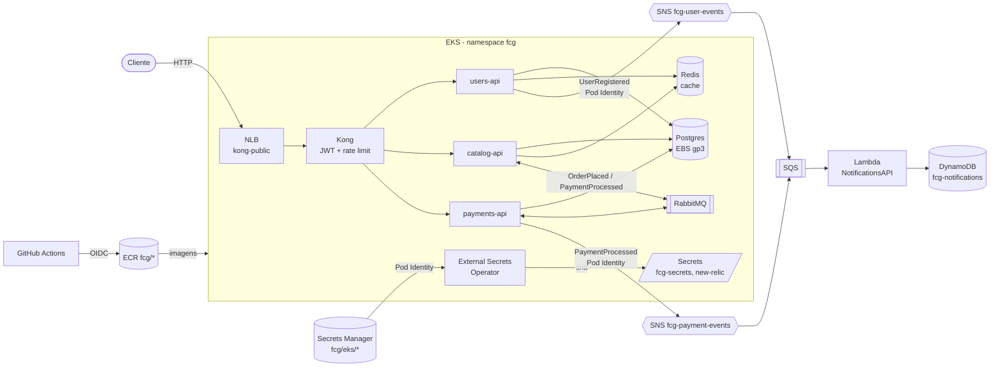

# Workloads no EKS, segredos e NoSQL

Como as APIs sobem no EKS sem nenhuma credencial no repositório, e onde fica o NoSQL do projeto.
A rede e o cluster estão em "Rede e cluster EKS" (`infra/cloudformation/vpc.yaml` e `eks.yaml`).

## Visão geral



## Segredos: zero credenciais no repositório

| Onde | O quê |
|---|---|
| `infra/cloudformation/workload-access.yaml` (stack `fcg-workload-access`) | Segredos `fcg/eks/postgres`, `fcg/eks/redis`, `fcg/eks/rabbitmq` (`username`/`password`) e `fcg/eks/jwt` (`secretKey`), **gerados pelo próprio Secrets Manager**. Ninguém digita nem vê as senhas. Também cria as roles dos pods. |
| `fcg/notifications/new-relic-license-key` | License key do New Relic, criada na fase 3 e reaproveitada. |
| `k8s/aws/workloads/00-cluster-secret-store.yaml` | Liga o External Secrets Operator ao Secrets Manager, autenticado pelo Pod Identity (sem access key). |
| `k8s/aws/workloads/01-external-secrets.yaml` | Monta os Secrets `fcg-secrets` e `new-relic` com **as mesmas chaves** do Minikube; as connection strings são montadas a partir de usuário/senha. Os Deployments não sabem de onde o valor veio. |

Postgres, Redis e RabbitMQ leem a senha do `fcg-secrets` (`secretKeyRef`), assim como as APIs e o Kong
(chave do JWT). No Minikube o mesmo Secret vem de `k8s/02-secret.yaml` (valores de exemplo) e do `.env`.

**Acesso à AWS sem chave guardada:**

| Quem | Como | Pode o quê |
|---|---|---|
| External Secrets Operator | Pod Identity → `fcg-eks-external-secrets` | ler `fcg/eks/*` e a license key do New Relic |
| users-api | Pod Identity → `fcg-eks-users-api` | `sns:Publish` em `fcg-user-events` |
| payments-api | Pod Identity → `fcg-eks-payments-api` | `sns:Publish` em `fcg-payment-events` |
| GitHub Actions | OIDC → `fcg-gha-*` | push no ECR do próprio serviço; deploy no namespace `fcg` via access entry (`eks.yaml`) |

As associações ServiceAccount → role ficam em `infra/cloudformation/pod-identity.yaml` (stack efêmera, junto do cluster).

## Deploy no EKS

```bash
make secrets-deploy        # uma vez: segredos + roles (permanente, ~US$ 1,60/mês)
make cluster-up            # cluster efêmero + Pod Identity (15-20 min)
make workloads-deploy      # ESO, Secrets, APIs com imagens do ECR, NLB do Kong
# ao terminar:
make cluster-down          # namespace fcg, Pod Identity e cluster, nesta ordem
```

O `cluster-up` sobe a stack `fcg-pod-identity` sozinho quando a `fcg-workload-access` já existe, e o
`cluster-down` a remove antes da `fcg-eks`. `make pod-identity-deploy` / `pod-identity-down` continuam
disponíveis para rodar separadamente.

`make workloads-deploy` (`scripts/aws/deploy-workloads.sh`) só roda no contexto `fcg-eks`, usa a tag mais recente
de cada repositório ECR (ou `USERS_API_TAG`/`CATALOG_API_TAG`/`PAYMENTS_API_TAG`) e termina mostrando o DNS do NLB.
Depende de `aws`, `kubectl` e `helm`.

**Zero downtime:** APIs e Kong usam `RollingUpdate` com `maxUnavailable: 0` e `maxSurge: 1`. Um pod novo só
recebe tráfego depois de passar na readiness probe, e só então um antigo sai. Para provar no vídeo, deixe um loop
de `curl` no DNS do NLB enquanto a pipeline faz o rollout.

## NoSQL: DynamoDB do NotificationsAPI

O NotificationsAPI é uma Lambda (SAM, repositório `FIAPCloudGames-fase4-NotificationsAPI`). Ela consome os eventos
de cadastro e de pagamento via SNS → SQS e grava cada notificação na tabela **`fcg-notifications`**, com o driver
oficial `AWSSDK.DynamoDBv2`.

| Item | Valor | Por quê |
|---|---|---|
| Chave de partição `PK` | `EVENT#<eventId>` (ou `NOTIFICATION#<id>` sem evento) | Idempotência: `PutItem` com `attribute_not_exists(PK)`, então a mensagem reentregue pela SQS não duplica |
| GSI `GSI1-UserId` | `UserId` (HASH) + `CreatedAt` (RANGE) | Padrão de acesso "notificações de um usuário, da mais recente para a mais antiga" sem `Scan` |
| Atributos | `Type`, `Status`, `RecipientEmail`, `RecipientName`, `Subject`, `Body`, `RetryCount`, `LastError` | Documento flexível; campos opcionais só existem quando preenchidos |
| Cobrança | `PAY_PER_REQUEST` | Sem custo parado; ideal para o volume do projeto |

**Por que NoSQL aqui:** notificação é um registro de evento, sem relacionamentos, gravado uma vez e lido por usuário.
Isso é chave-valor com um índice secundário, o caso típico do DynamoDB. Não precisa de joins nem de transações
entre tabelas, como os dados de usuários, jogos e pedidos no Postgres.
